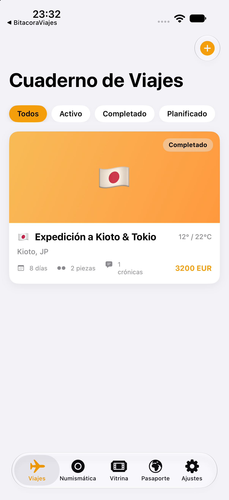

# Bitácora de Viajes en Pareja (iOS)

[](https://swift.org)
[](https://developer.apple.com/ios/)
[](https://developer.apple.com/xcode/swiftdata/)
[](https://developer.apple.com/xcode/swift-testing/)
[](LICENSE)

An elegant, offline-first native iOS application designed for couples to chronicle expeditions, curate numismatic treasures with real-time 3D rotation, split travel expenses effortlessly, and export bespoke editorial books.

---

## Visual Preview

| Expediciones & Crónica | Gabinete Numismático 3D |
| :---: | :---: |
|  |  |

---

## Key Features

### 📖 Dual-Voice Chronicles
- Simultaneous, side-by-side journaling from two distinct traveler viewpoints.
- Chronological timeline tracking daily highlights, weather conditions, and mood.
- Open-Meteo integration providing historical temperatures and forecasts.

### 🪙 Interactive 3D Numismatic Cabinet
- Tactile 180° coin and banknote flip cards rendered with Metal-backed acceleration (`.compositingGroup()`) for locked 120 FPS ProMotion displays.
- Built-in AI Vision scanner (`Vision` + `CoreImage`) that automatically isolates circular coin contours, eliminates outer backgrounds, and enhances metallic relief.

### 💶 Shared Expense Splitter & Analytics
- Automated 50/50 balance settlement ("Who owes whom") supporting multicurrency expenses.
- Native interactive donut charts built with Swift Charts (`SectorMark`).
- Quick-add sheet with category tags, custom split options, and decimal inputs.

### 🏝️ Live Activities & Dynamic Island (`ActivityKit`)
- Real-time journey banner on the Lock Screen and Dynamic Island displaying active city, elapsed days, and current journal count.
- WidgetKit widgets for Home Screen expedition countdowns and memory throwbacks.

### 🔒 Privacy-First & Hardware Security
- Zero analytics, zero ad trackers, and 100% offline autonomy.
- Sensitive authentication keys and API credentials secured via `Security.framework` and the iOS Secure Enclave.
- Optional biometric protection using Face ID / Touch ID (`LocalAuthentication`).
- App Store privacy manifest (`PrivacyInfo.xcprivacy`) declaring required reason `CA92.1`.

### ☁️ CloudKit Synchronization
- Transparent syncing across devices via private iCloud container (`cloudKitDatabase: .automatic`) with seamless offline fallback.

### 🌍 Internationalization
- Bilingual architecture powered by String Catalogs (`Localizable.xcstrings`) supporting both Spanish (`es`) and English (`en`).

---

## Technical Stack & Architecture

- **Language:** Swift 6 with strict concurrency checking enabled.
- **UI Framework:** SwiftUI (MVVM architecture utilizing `@Observable` and `@MainActor`).
- **Data Persistence:** SwiftData (`@Model`) with relational cascades.
- **Image Pipeline:** `ImageIO` downsampling (`CGImageSourceCreateThumbnailAtIndex`) reducing memory consumption by 95%.
- **System Frameworks:** ActivityKit, WidgetKit, AppIntents, Vision, CoreImage, Charts, MapKit, TipKit, LocalAuthentication, PDFKit, PhotosUI.
- **Project Generation:** XcodeGen for reproducible, clean project structures without pbxproj merge conflicts.

---

## Directory Layout

```text
bitacora-viajes-ios/
├── BitacoraViajes/
│   ├── BitacoraViajesApp.swift       # App lifecycle, SwiftData container & CloudKit setup
│   ├── Intents/                      # Siri Shortcuts & Spotlight search integration
│   ├── LiveActivities/               # ActivityKit attributes and dynamic manager
│   ├── Models/                       # SwiftData models (Trip, TripLog, Artifact, Expense)
│   ├── Resources/                    # Assets, Info.plist, PrivacyInfo & Localizable strings
│   ├── Services/                     # Keychain, ImageOptimizer, CoinScanner, Weather & PDF
│   ├── ViewModels/                   # State management & business logic
│   ├── Views/                        # Modular SwiftUI screens and components
│   └── Widgets/                      # WidgetKit timeline providers and views
├── BitacoraViajesTests/              # Swift Testing suite (CountryCatalog, Expenses, Keychain)
├── assets/screenshots/               # Visual previews and assets
├── project.yml                       # Declarative project specification (XcodeGen)
└── .github/workflows/ci.yml          # Automated CI pipeline
```

---

## Getting Started

### Prerequisites

- macOS 14.0 or later
- Xcode 16.0 or later (Xcode 27.2 verified)
- [XcodeGen](https://github.com/yonaskolb/XcodeGen) (`brew install xcodegen`)

### Setup & Run

1. Clone the repository:
   ```bash
   git clone https://github.com/Wacko87/bitacora-viajes-ios.git
   cd bitacora-viajes-ios
   ```

2. Generate the Xcode project:
   ```bash
   xcodegen generate
   ```

3. Open and build:
   ```bash
   open BitacoraViajes.xcodeproj
   ```

### Running Unit Tests

Execute the automated test suite with `xcodebuild`:

```bash
xcodebuild test \
  -project BitacoraViajes.xcodeproj \
  -scheme BitacoraViajes \
  -destination "platform=iOS Simulator,name=iPhone 18 Pro"
```

---

## License

This project is licensed under the terms of the MIT License.
